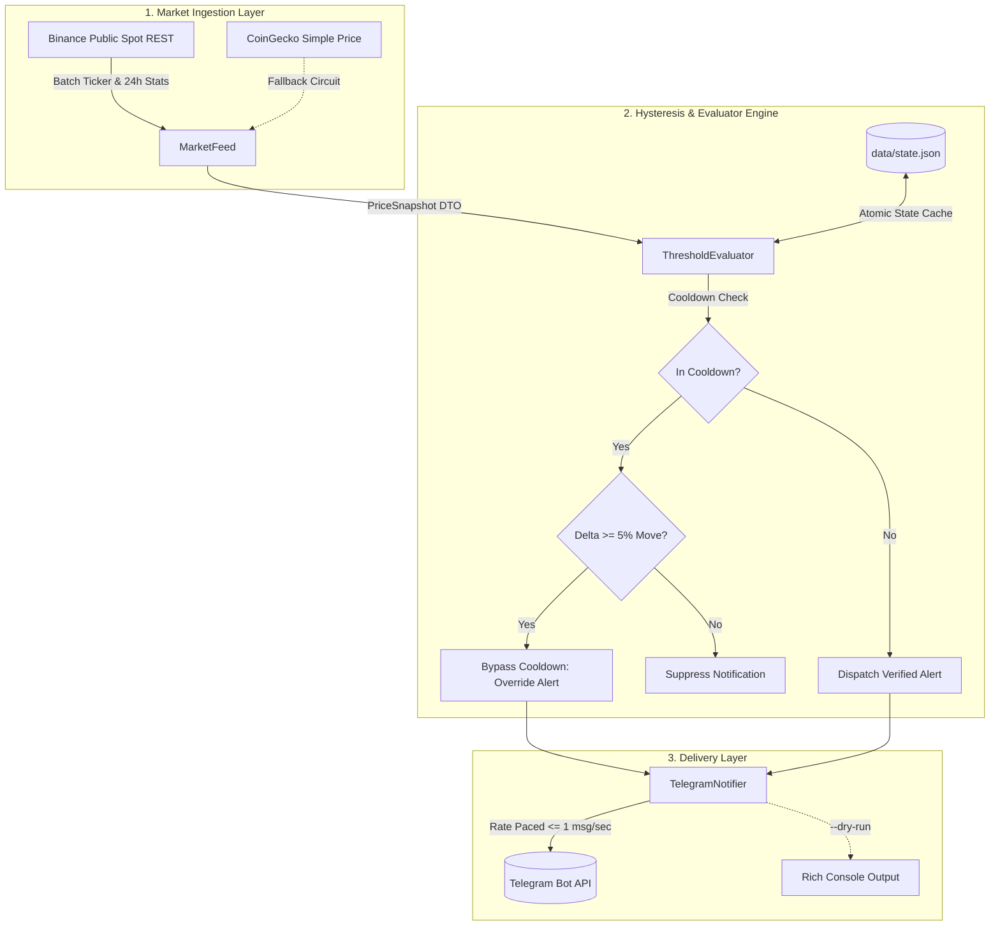

<div align="center">

# ⚡ SentinelPulse: Crypto & Asset Threshold Monitor 📡

**An autonomous, ultra-lightweight, 24/7 financial daemon dispatching real-time Telegram alerts with intelligent anti-spam hysteresis.**

[](https://www.python.org/)
[](https://opensource.org/licenses/MIT)
[](https://www.python-httpx.org/)
[](https://docs.pydantic.dev/)
[](Code_Review_Report.md)

<p align="center">
  <a href="#-architecture--workflow">Architecture</a> •
  <a href="#-key-features">Features</a> •
  <a href="#-quickstart">Quickstart</a> •
  <a href="#-configuration">Configuration</a> •
  <a href="#-daemon--service-setup">24/7 Deployment</a> •
  <a href="#-testing">Testing</a> •
  <a href="#-security--code-review">Audit Report</a>
</p>

---

</div>

## 🎯 Overview

Most casual crypto price monitors either charge costly monthly subscriptions, require bloated browser automation, or spam your phone with 50 notifications whenever a coin hovers around a threshold line.

**SentinelPulse** is a clean, single-tenant, self-hosted Python daemon built to run 24/7 on a Linux VPS or home workstation. It requires **zero API keys for market data**, operates under **<25 MB of RAM**, and uses an **in-memory + atomic disk hysteresis state machine** that guarantees you only receive alerts that matter.

```
🚨 PRICE ALERT: Bitcoin (BTC) 🚨

📈 Condition: Upper Limit Breached! 🚀
💰 Current Price: $81,666.00
🎯 Target Level: $70,000.00 (+16.67%)
📊 24h Change: -1.08%
⏰ Timestamp: 2026-10-20 18:00:00 UTC

Notification suppressed for 60m unless price moves ±5.0%.
```

---

## 🏛️ Architecture & Workflow



---

## ✨ Key Features

- 🆓 **Zero Market Data API Keys:** Reads directly from high-capacity Binance public ticker endpoints with automatic CoinGecko failover.
- 🛡️ **Hysteresis Anti-Spam Cooldown:** Suppresses repetitive alerts for a configurable duration (default: 60 minutes) when price fluctuates along threshold borders.
- ⚡ **Dynamic Delta Override:** If the price makes a violent leap ($\ge 5\%$) beyond the previously alerted price, the cooldown is instantly overridden.
- 💾 **Atomic State Persistence:** State is written to temporary files and atomically replaced (`data/state.json`) — preserving cooldown status across daemon restarts with zero file corruption risk.
- 🚦 **Rate-Limited Dispatching:** Built-in token bucket / pacing mechanism guarantees your bot never violates Telegram's 1 msg/sec per-chat rate limits.
- 🔒 **Enterprise-Grade Security:**
  - Token masking in diagnostic logs.
  - HTML entity escaping prevents payload injection into Telegram messages.
  - Full `.gitignore` and `.env.example` protection.
- 🖥️ **Cross-Platform Background Runners:** Ready-made Linux `systemd` service unit and silent Windows `.vbs` runner.

---

## 🚀 Quickstart

### 1. Clone & Set Up Virtual Environment

```bash
# Clone the repository
git clone https://github.com/yourusername/crypto-alert-monitor.git
cd crypto-alert-monitor

# Create virtual environment
python3 -m venv venv

# Activate virtual environment
source venv/bin/activate      # Linux / macOS
# or: venv\Scripts\activate   # Windows

# Install dependencies
pip install -r requirements.txt
```

### 2. Configure Your Watchlist (`config/targets.json`)

Configure your target symbols, upper/lower trigger boundaries, and cooldown windows:

```json
{
  "poll_interval_seconds": 30,
  "default_cooldown_minutes": 60,
  "significant_move_override_percent": 5.0,
  "targets": [
    {
      "symbol": "BTCUSDT",
      "display_name": "Bitcoin (BTC)",
      "upper_limit": 80000.0,
      "lower_limit": 65000.0,
      "cooldown_minutes": 60
    },
    {
      "symbol": "ETHUSDT",
      "display_name": "Ethereum (ETH)",
      "upper_limit": 3000.0,
      "lower_limit": 2200.0,
      "cooldown_minutes": 60
    },
    {
      "symbol": "SOLUSDT",
      "display_name": "Solana (SOL)",
      "upper_limit": 150.0,
      "lower_limit": 90.0,
      "cooldown_minutes": 30
    }
  ]
}
```

### 3. Test Immediately in Dry-Run Mode (No Keys Needed!)

You don't need a Telegram account to start watching prices right now:

```bash
# Poll once and output formatted cards to terminal
python3 main.py --dry-run --once

# Or run the continuous live terminal monitor
python3 main.py --dry-run
```

---

## 🤖 Telegram Bot Integration

### 1. Obtain Your Credentials
1. Open Telegram and message [@BotFather](https://t.me/BotFather). Send `/newbot` to create your bot and copy your **Bot Token**.
2. Message [@userinfobot](https://t.me/userinfobot) to get your numeric **Chat ID**.
3. Open a direct chat with your new bot and click **Start** (required to allow it to message you).

### 2. Store Credentials Safely
Copy the template and edit `.env`:
```bash
cp .env.example .env
```

```ini
TELEGRAM_BOT_TOKEN="123456789:ABCdefGHIjklMNOpqrSTUvwxYZ"
TELEGRAM_CHAT_ID="987654321"
LOG_LEVEL="INFO"
```

### 3. Test Connectivity
Validate your bot credentials and chat ID with the built-in diagnostic tool:
```bash
python3 test_telegram.py
```

### 4. Run the Production Daemon
```bash
python3 main.py
```

---

## ⚙️ CLI Reference

```text
usage: main.py [-h] [-c CONFIG] [--state STATE] [--dry-run] [--test-alert] [--once]

options:
  -h, --help            Show this help message and exit
  -c, --config CONFIG   Path to targets JSON configuration (default: config/targets.json)
  --state STATE         Path to persistent state JSON file (default: data/state.json)
  --dry-run             Render alerts in rich terminal cards without sending to Telegram
  --test-alert          Send a test ping message to Telegram upon startup
  --once                Execute a single evaluation cycle and terminate (cron-ready)
```

---

## 🛠️ 24/7 Deployment Options

### Option A: Linux VPS via `systemd` (Recommended)

1. Adjust the file paths in `scripts/crypto-monitor.service` to match your user directory:
   ```ini
   WorkingDirectory=/path/to/crypto-alert-monitor
   ExecStart=/path/to/crypto-alert-monitor/venv/bin/python3 main.py
   ```
2. Enable and start the system service:
   ```bash
   sudo cp scripts/crypto-monitor.service /etc/systemd/system/
   sudo systemctl daemon-reload
   sudo systemctl enable --now crypto-monitor.service
   ```
3. Monitor logs in real time:
   ```bash
   journalctl -u crypto-monitor.service -f
   ```

### Option B: Windows Silent Background Runner

Double-click `scripts/run_background_win.vbs`. It invokes `pythonw.exe` from your local virtual environment without keeping an active command prompt window open.

---

## 🧪 Testing

SentinelPulse comes with a comprehensive test suite covering data validation, breach detection, cooldown suppression, delta bypass, and network backoff:

```bash
# Run test suite
pytest -v
```

```text
tests/test_monitor.py::test_target_config_normalization_and_validation PASSED [ 14%]
tests/test_monitor.py::test_threshold_breach_detection PASSED            [ 28%]
tests/test_monitor.py::test_hysteresis_cooldown_suppression PASSED       [ 42%]
tests/test_monitor.py::test_significant_move_delta_override PASSED       [ 57%]
tests/test_monitor.py::test_state_persistence_across_instances PASSED    [ 71%]
tests/test_monitor.py::test_telegram_html_formatting PASSED              [ 85%]
tests/test_monitor.py::test_feed_exponential_backoff_and_resilience PASSED [100%]

============================== 7 passed in 0.25s ===============================
```

---

## 🛡️ Security & Code Quality Audit

This codebase has undergone a rigorous internal audit following `/security-patterns` and `/api-patterns` standards. Full findings and mitigations are documented in [Code_Review_Report.md](Code_Review_Report.md).

- **OWASP Protection:** Dynamic content HTML-escaped before dispatch.
- **Credential Safety:** Zero tokens logged or displayed in diagnostic tools.
- **Fail-Safe Loop:** Exponential jitter backoff guarantees zero daemon crashes on ISP drops.

---

## 📄 License

Distributed under the [MIT License](LICENSE). Built for traders, automated infrastructure enthusiasts, and DevOps engineers.
